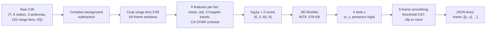

# Multi-Person Indoor Localization with UWB Radar and TinyML

Estimates the 2D positions of **up to four people** in a 4.8 × 7.2 m room from the raw signals of **six UWB radars**, using a **577.9 KB, fully INT8** network that fits the budget of an **ESP32-S3** microcontroller (Flash < 800 KB, SRAM arena < 300 KB).

Course project for *Embedded and Edge Artificial Intelligence*, Politecnico di Milano, A.Y. 2025-26.
Authors: Sneharajalakshmi Palanisamy (code, model and experiments), Marco Orlando Conte (report). Full write-up: [`report/report.pdf`](report/report.pdf).

## Results

Evaluated on 4 held-out acquisition windows (whole 300 s recordings, never used for training). A prediction counts as correct if it is within 1.0 m of a person, matched per frame with the Hungarian algorithm.

| Metric | Value |
|---|---|
| F1 detection score (INT8 model, presence threshold 0.87) | **0.8535** |
| Person-count accuracy | 0.9355 |
| Median localization error (matched detections) | **0.357 m** |
| 90th-percentile localization error (matched detections) | 0.785 m |
| 5-fold cross-validation F1 (22 labelled windows) | 0.843 ± 0.032 |
| Model size | 577.9 KB (limit 800 KB) |
| Activation arena (upper bound) | 212.4 KB (limit 300 KB) |

F1 by number of people in the room: **1.00** (empty), **0.996** (1), **0.987** (2), **0.778** (3), **0.827** (4). Most of the remaining error comes from crowded scenes.

### Quantization

Post-training full-integer INT8 quantization, calibrated on 200 training samples, costs 0.006 F1 for a 3.6× smaller model:

| | float32 | INT8 |
|---|---|---|
| Model size | 2.03 MB | **577.9 KB** |
| Validation F1 | 0.8597 | 0.8535 |
| Count accuracy | 0.9376 | 0.9355 |

### Hardware constraints (official checker)

| Check | Limit | Measured | |
|---|---|---|---|
| TFLite validity | loads and allocates | input (1, 6, 3, 60, 6) int8, output (1, 4, 3) int8 | pass |
| Model file size | < 800 KB | 577.9 KB (72% of budget) | pass |
| Activation arena | < 300 KB | 212.4 KB (71% of budget) | pass |
| Forbidden ops (LSTM, GRU, RNN, custom, Flex) | none | none detected | pass |
| Quantization | INT8 recommended | full INT8 | pass |

## How it works



1. **Background subtraction in the complex domain.** The two empty-room recordings are averaged into a static template (per radar, antenna and range bin) and subtracted from the I/Q samples, not the magnitudes, so a person standing near a strong static reflector is not lost to phase cancellation.
2. **Range-bin crop.** Bins 0-4 (direct transmitter-to-receiver coupling) are dropped; bins 5-64 cover up to 9.6 m, beyond the 8.65 m room diagonal.
3. **Doppler and CFAR features.** For each 64-frame window (2.56 s at 25 Hz): mean and standard deviation of the residual magnitude, three slow-time Doppler-band energies (low: breathing and micro-motion, mid: sway and slow walking, high: fast limb motion), and a CA-CFAR contrast against the local noise floor. The input tensor is about **40× smaller** than the raw I/Q window.
4. **Normalization.** `log1p` compression, then a Z-score with statistics computed on the training set only and frozen for inference.
5. **Room-symmetry augmentation.** The room layout is symmetric, so horizontal and vertical flips are exactly equivalent to permuting the radar axis. This triples the training set (8,370 to 25,110 windows) without new data and without randomness.
6. **Model.** A small residual CNN with squeeze-and-excitation blocks, built only from TFLite-Micro-supported ops (Conv2D, BatchNorm, ReLU, MaxPool, GlobalAveragePooling, Dense, Add, Multiply). Dilation and pooling act along the range axis only, so the six radars are not collapsed early.
7. **Permutation-invariant loss.** The output is four unordered slots of (x, y, presence logit). The loss takes the minimum over all 4! = 24 slot permutations of masked position MSE plus 0.7 × presence BCE, which is the optimal assignment as a single GPU-friendly tensor operation. The Hungarian algorithm is used only in the evaluator.
8. **Decoding.** Sliding window with stride 1 (every frame gets a prediction), 5-frame moving average of the presence probabilities, a validation-calibrated threshold of 0.87, coordinates clipped to the room.

Training: Adam (lr 1e-3, gradient clipping 1.0), batch 128, up to 120 epochs with early stopping and learning-rate halving on plateau. Whole-window train/validation splits (windows 3, 9, 14, 18 held out) avoid near-duplicate frames leaking across the split.

## Stability across data splits

To check that the result does not depend on which windows were held out, the full training was repeated with 5-fold cross-validation over the 22 labelled windows (the threshold is calibrated per fold). Calibrated F1 is 0.843 ± 0.032, precision 0.814 ± 0.041, recall 0.854 ± 0.050. The best fold reaches 0.892 and the worst 0.797.

## Limitations

- The presence threshold (0.87) is calibrated on the same validation windows that are then scored, so the headline F1 is somewhat optimistic. The cross-validation also reports F1 at a fixed 0.5 threshold (mean 0.833) for comparison.
- Validation covers only 4 of 22 labelled windows; the cross-validation above is the better estimate of spread.
- Localization errors are computed over matched detections only (within 1.0 m), so they describe the accuracy of detections that already count as correct.
- Performance drops with 3 and 4 people (F1 0.778 and 0.827), where radar reflections overlap.
- The course's final evaluation used a separate, unseen session; that score is not reproduced here. The example input used for the format check is derived from training data and is not used for any number above.

Ideas for future work (from the report): a heat-map output with peak extraction instead of fixed slots, a lightweight tracker (constant velocity with Hungarian association) over the predictions, a presence threshold that adapts to the estimated person count, and quantization-aware training if later architectures become more sensitive to quantization.

## Repository layout

```
submission/
  code.py                       inference script (CIR .npy in, JSON lines out)
  model.tflite                  INT8 model (577.9 KB)
src/
  EEAI_10826144_11132155.ipynb  features, model, training, quantization, export
  EEAI_experiments.ipynb        held-out check and 5-fold cross-validation
  EEAI_Results.pdf              submission results from the evaluation and constraint scripts
report/
  report.pdf                    full project report
evaluation/                     provided by the course (do not modify)
  evaluate_performance.py       output-format check and F1 / localization metrics
  evaluate_constraint.py        ESP32-S3 constraint check for the TFLite model
  example/
    input_test.npy              example CIR input
    output_test.jsonl           matching ground truth
requirements.txt                allowed libraries (do not modify)
```

`evaluation/` (scripts and example data) was provided by the course and is included only so the results can be reproduced; it is not covered by this repository's license.

## Quick start

```bash
pip install -r requirements.txt
python submission/code.py --input-path cir.npy --output-path predictions.jsonl
```

`cir.npy` is a float array of shape `(T, 6, 3, 120, 2)`: frames, radars, antennas, range bins, I/Q. Each recording of the course dataset stores it under the key `radar_cir_iq` in its `.npz` file (`np.save("cir.npy", np.load(window)["radar_cir_iq"])`). The output has one line per frame: `{"frame": 0, "localizations": [[x, y], ...]}` with 0 to 4 positions in meters.

The script runs the model with `tf.lite.Interpreter` and expects `model.tflite` in the same folder as `code.py`. The background template and normalization statistics are embedded in `code.py`, so no other files are needed.

> **Note:** `tf.lite.Interpreter` is deprecated and scheduled for removal in TensorFlow 2.20. If `pip install -r requirements.txt` pulls in TensorFlow 2.20 or later, install an earlier version (`pip install "tensorflow<2.20"`) to run `code.py` as is.

### Evaluate locally

Run these commands from the repository root.

1. Run inference on the example input:
   ```bash
   python submission/code.py \
       --input-path  evaluation/example/input_test.npy \
       --output-path evaluation/example/my_output.jsonl
   ```
2. Check the output format and compute the metrics against the example ground truth:
   ```bash
   python evaluation/evaluate_performance.py \
       --gt-path   evaluation/example/output_test.jsonl \
       --pred-path evaluation/example/my_output.jsonl
   ```
3. Check the model against the ESP32-S3 constraints:
   ```bash
   python evaluation/evaluate_constraint.py \
       --model-path submission/model.tflite
   ```

The example input is derived from training data, so these scores are only a format and sanity check. The outputs of steps 2 and 3 for the submitted model are collected in [`src/EEAI_Results.pdf`](src/EEAI_Results.pdf).

### Retraining

The notebooks in `src/` were developed on Google Colab and need a GPU runtime. `requirements.txt` covers only inference; the notebooks rely on the packages preinstalled on Colab (including the full TensorFlow/Keras stack). They read the course dataset from a Google Drive path set in one cell near the top.

## Data

The dataset (24 acquisition windows of 300 s, six TSRR250 UWB radars, ground-truth positions for up to four people) was provided by the course and is **not** included. `submission/code.py` contains only derived quantities: the averaged empty-room template and the training-set normalization statistics.

## References

1. F. Fioranelli, E. Rufas, A. Yarovoy. *Multiple People Detection & Localization with Multi-static UWB Radar in Vehicle Cabin.* iWAT, 2024.
2. M. Pavan, A. Caltabiano, M. Roveri. *TinyML for UWB-radar based Presence Detection.* IJCNN, 2022.
3. S. Campaña-Bastidas, M. Espinilla-Estévez, J. Medina-Quero. *Review of Ultra Wide Band (UWB) for Indoor Positioning with Application to the Elderly.* HICSS, 2022.
4. M. A. Richards. *Fundamentals of Radar Signal Processing.* McGraw-Hill, 2nd ed., 2014.

## License

Apache License 2.0, see [LICENSE](LICENSE).
